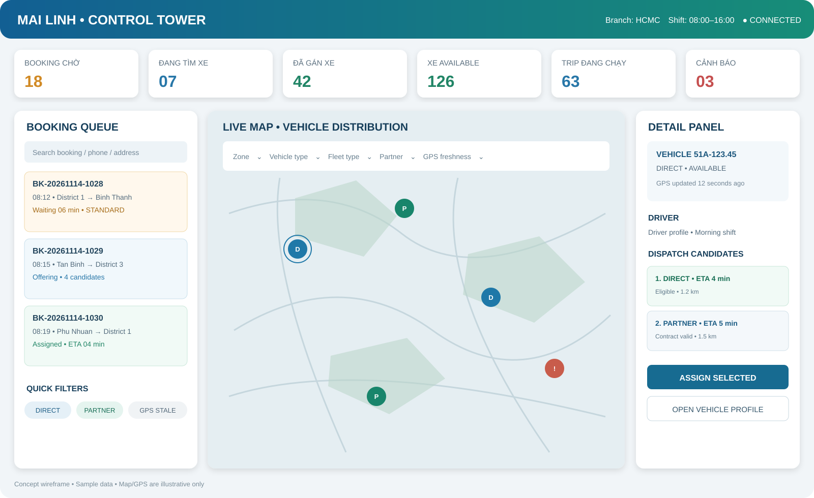
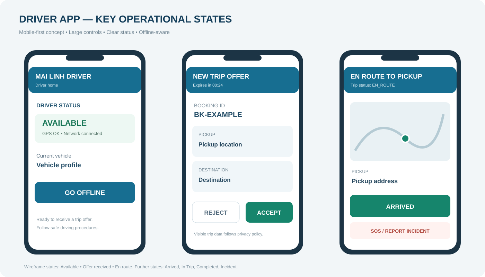

# MAI LINH TAXI — SYSTEM IMPLEMENTATION DOCUMENTATION

> **Bộ tài liệu triển khai nền tảng Taxi Mai Linh** · Version 1.0-draft · 2026-11-14  
> **Mô hình:** DIRECT + PARTNER trên một nền tảng điều phối thống nhất.  
> **Trạng thái:** Development planning baseline — pending business, finance, legal and architecture approvals.

## Mục tiêu và phạm vi sử dụng

Bộ tài liệu dành cho Business Owner, Operations, Finance, Legal, BA/PO, UX/UI, Architect, Developer, QA và IT Operations để thống nhất yêu cầu, thiết kế, phát triển, kiểm thử, nghiệm thu và vận hành.

Bản 1.0 bổ sung đặc tả triển khai chi tiết cho bản nền tảng 0.9. Đây chưa phải production sign-off: các quyết định chính sách, thông số tải, nhà cung cấp, bảo mật pháp lý và dữ liệu nguồn phải được chủ sở hữu phê duyệt.

## Nguyên tắc nền tảng

1. Một dispatch platform phục vụ xe/tài xế Mai Linh quản lý trực tiếp (**DIRECT**) và xe/tài xế đối tác (**PARTNER**).
2. `booking_channel` khác `fleet_type`. Kênh HOTLINE/APP/WEB/API không quyết định nguồn lực DIRECT/PARTNER.
3. Dispatch engine có thể dùng chung; điều kiện hợp đồng, doanh thu, công nợ và settlement phải phân biệt.
4. Fare và settlement lưu snapshot phiên bản tariff/contract/policy tại thời điểm nghiệp vụ.
5. Event vận hành và ledger phải truy vết; không xóa lịch sử để sửa dữ liệu.
6. Mọi lệnh ghi quan trọng phải có authorization, audit, idempotency và xử lý concurrency.
7. Chính sách chưa được phê duyệt phải để TBD; không dùng giá trị giả định làm cấu hình production.

## Danh mục tài liệu nền tảng (00–17)

| # | Tài liệu | Phạm vi |
|---|---|---|
| 00 | [Executive Overview](./00-Executive-Overview.md) | Mục tiêu, scope, nguyên tắc, approval gates |
| 01 | [BRD](./01-BRD-Business-Requirements.md) | Business objectives, stakeholders, capabilities, KPI |
| 02 | [Operating Model](./02-Operating-Model.md) | DIRECT/PARTNER, roles, eligibility |
| 03 | [End-to-End Workflows](./03-End-to-End-Workflows.md) | Booking, dispatch, trip, payment, settlement, incident |
| 04 | [SRS](./04-SRS-Functional-Requirements.md) | Requirement IDs, business rules, state model |
| 05 | [UI/UX](./05-UIUX-Specification.md) | Screen inventory, fields, interactions, states |
| 06 | [Dispatch & Control Tower](./06-Dispatch-Control-Tower.md) | Candidate logic, map, queue, exceptions |
| 07 | [Driver App](./07-Driver-App.md) | Mobile journey, states, offline/safety |
| 08 | [Fare/Payment/Settlement](./08-Fare-Payment-Settlement.md) | Tariff, payment, ledger, partner settlement |
| 09 | [Data Model & ERD](./09-Data-Model-ERD.md) | Domain entities, relationships, constraints |
| 10 | [API & Integration](./10-API-Integration.md) | API, events, contracts, integrations |
| 11 | [Architecture/NFR/Security](./11-Architecture-NFR-Security.md) | Logical architecture, resilience, security, DR |
| 12 | [QA/UAT/Acceptance](./12-QA-UAT-Acceptance.md) | Test strategy, test cases, acceptance gates |
| 13 | [Delivery/Deployment](./13-Delivery-Deployment-Plan.md) | Workstreams, environments, migration, cutover |
| 14 | [Operations/Runbooks](./14-Operations-Runbooks.md) | Monitoring, incident, backup/restore |
| 15 | [Decision Register](./15-Decision-Register.md) | TBD, owners, priorities, approvals |
| 16 | [Traceability](./16-Traceability-Matrix.md) | BRD → SRS → Flow → UI/API → Test |
| 17 | [Glossary](./17-Glossary.md) | Thuật ngữ thống nhất |

## Đặc tả bổ sung cho Development Ready (18–30)

| # | Tài liệu | Nội dung |
|---|---|---|
| 18 | [Implementation Blueprint](./18-Implementation-Blueprint.md) | Bounded contexts, invariants, topology, release slices |
| 19 | [Detailed Dispatch Rules](./19-Detailed-Dispatch-Rules.md) | Hard filters, scoring, offers, concurrency, exception matrix |
| 20 | [API Contracts & Examples](./20-API-Contracts-Examples.md) | Endpoint inventory, JSON examples, error/event envelopes |
| 21 | [Data Dictionary & Constraints](./21-Data-Dictionary-and-Constraints.md) | Entity fields, indexes, money, lifecycle, integrity |
| 22 | [UI Screen Behavior](./22-UI-Screen-Behavior-Spec.md) | Screen inventory, actions, validation, states, handoff |
| 23 | [Role & Permission Matrix](./23-Role-Permission-Matrix.md) | Role scopes, sensitive actions, maker-checker |
| 24 | [NFR, Capacity & Resilience](./24-NFR-Capacity-and-Resilience.md) | SLO worksheet, capacity inputs, load, DR, security |
| 25 | [QA Test Catalog](./25-QA-Test-Catalog.md) | E2E, security, financial reconciliation, acceptance |
| 26 | [Delivery Backlog & Sprint Plan](./26-Delivery-Backlog-and-Sprint-Plan.md) | Epics, dependencies, stories, Definition of Done |
| 27 | [Production Readiness](./27-Production-Readiness-Checklist.md) | Go-live checklist and go/no-go record |
| 28 | [Decision Workshop Pack](./28-Decision-Workshop-Pack.md) | Business decisions, owners, evidence and approvals |
| 29 | [Integration & Provider Matrix](./29-Integration-and-Provider-Matrix.md) | Provider requirements, failure behavior, onboarding |
| 30 | [Data Migration & Cutover](./30-Data-Migration-and-Cutover-Plan.md) | Mapping, rehearsal, cutover, rollback |

## Visual assets

- 
- 
- 
- 

Wireframes are conceptual references, not production Figma prototypes. Maps and sample data are illustrative.

## Cách sử dụng theo vai trò

- Business Owner/Operations/Finance/Legal: xác nhận 00–03, 08, 15 và 28.
- BA/PO: quản lý requirement IDs tại 04, 16; bổ sung acceptance criteria và decision trace.
- UX/UI: dùng 05–07, 22 để tạo Figma prototype đầy đủ trạng thái.
- Architect/Developer: dùng 09–11, 18–21, 23–24, 29 để chốt thiết kế vật lý, OpenAPI và schema.
- QA: dùng 12, 16, 25 để xây test suite và evidence.
- IT Operations: dùng 13–14, 24, 27, 30 để chuẩn bị môi trường, DR, cutover và vận hành.

## Approval gates

1. **Business Baseline:** nghiệp vụ DIRECT/PARTNER, booking, dispatch, fare, cancellation, payment và settlement được ký duyệt.
2. **Solution Baseline:** architecture, ERD vật lý, API OpenAPI, security model, NFR và provider được duyệt.
3. **Development Ready:** story có acceptance criteria, UX state, API/data dependency và test coverage.
4. **UAT Ready:** môi trường, test data, test cases và người nghiệm thu được xác nhận.
5. **Production Ready:** checklist 27 đạt, restore/DR được thử, tài chính đối soát, support/on-call sẵn sàng.

## Trạng thái tài liệu

Draft → In Review → Approved → Baseline. Khi đã Baseline, mọi thay đổi phải qua Change Request và đánh giá ảnh hưởng.

> **Không được tự giả định:** biểu giá, phụ phí, phí hủy/no-show, tỷ lệ chia PARTNER, ưu tiên DIRECT/PARTNER, bán kính tìm xe, offer timeout, SLA/KPI, tải thiết kế, RPO/RTO, quy định lưu trữ dữ liệu và nhà cung cấp tích hợp. Các mục này phải được owner phê duyệt trước production.
